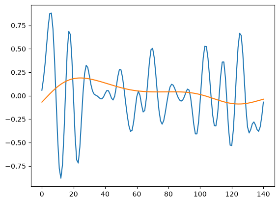
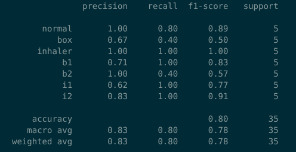
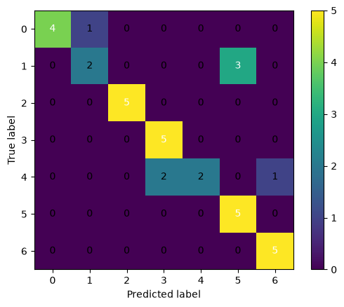
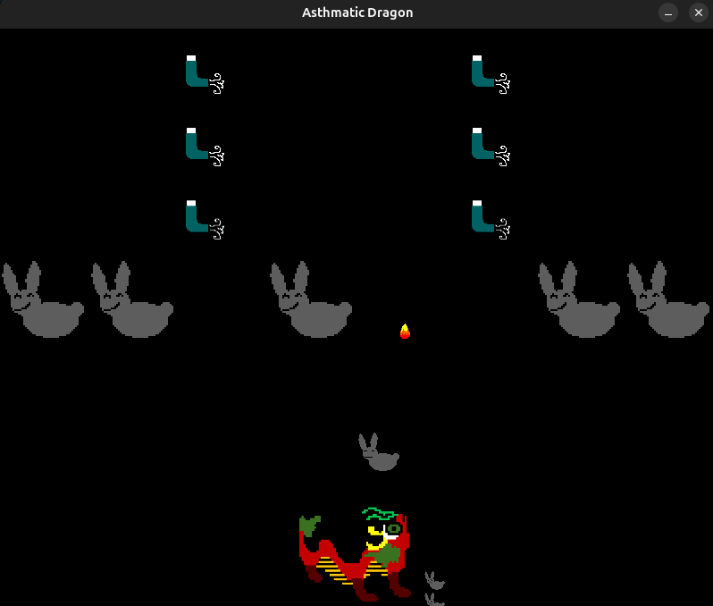

# Asthmatic Dragon

## Overview

This is my final project for CSCS 5280 at UNT (AI in Healthcare). The final project is a serious game that utilizes remote photoplethysmography (rPPG), machine learning, and gamification to teach people with asthma how to inhale their rescue medication properly, a certain breathing exercise (box breathing), and the importance of trigger avoidance.

## Technical Details

### Remote Photoplethysmography Component

Remote photoplethysmography (rPPG) is a contactless technology that measures heart rate and respiration via computer vision techniques that detect subtle changes in skin color. rPPG is used in the data collection process by recording videos of me doing certain breathing techniques and extracting blood volume pressure (BVP) and respiration signals from the videos via the BigSmall deep learning model. The signals are then cleaned using a digital band pass filter and are used to train a machine learning model.

### Machine Learning

The machine learning library used to classify the BVP and respiration signals is tslearn, which can handle multivariate time series of varying duration. The machine learning algorithms tested are a support vector machine (SVM) model that is specifically designed for time series classification and k-nearest neighbor that uses dynamic time warping as a distance measure for time series classification. Ultimately, the SVM model is chosen for its higher accuracy result.

### Gamification

The game will be based off of Space Invaders. The main character is a dragon with asthma who must destroy dust bunnies while also avoiding them. Whenever the dragon comes in contact with a dust bunny, he will have an asthma attack and must use an inhaler to relieve his symptoms. This is where the ML model comes in to detect if the player can inhale their medicine properly. The act of detecting breathing patterns serves as a game mechanic to advance in the game. There are only 5 inhalers in the game though, so players must learn to avoid triggers. There will also be power-ups that the player can collect and use by doing box breathing exercises.

## Results

### rPPG Plots

Here is an example plot of a BVP and respiration signal of a sample box breathing exercise.

### ML Model

Here is the classification accuracy report and confusion matrix for the SVM model.

Here is the confusion matrix for the SVM model.

### Game

Here are screenshots of the gameplay.

